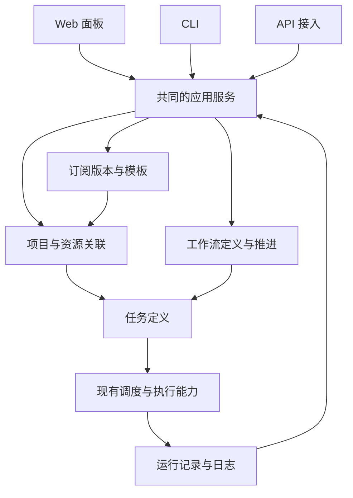

# 青龙产品与架构演进方案

日期：2026 年 11 月 22 日

状态：演进提案

首期目标：交付最小项目工作台

青龙下一阶段的方向是从定时脚本管理发展为轻量自动化工作台。围绕用户想完成的一件事，把脚本、任务、配置、运行过程和结果组织起来，再逐步支持多个任务协作以及完整方案的复用。

产品主线按三个阶段推进：**项目工作台 → 任务编排 → 订阅版本与方案模板**。架构演进贯穿三个阶段，围绕实际交付逐步明确模块职责。

## 产品目标

用户使用青龙，最终希望某件事情能按预期完成。例如每日采集数据并生成报告、同步多个来源的数据，或者定期检查状态并发送通知。脚本、依赖、变量和定时规则都是完成这件事所需的组成部分。

演进后的主要使用路径是：创建或导入一个项目，补齐运行配置，调试其中的任务，观察执行结果，再持续更新和复用这个项目。

产品应让用户容易回答四个问题：

- 这件事需要哪些任务、脚本和配置？
- 当前执行到哪里，等待或失败发生在哪一步？
- 修改脚本、规则或订阅后，会影响哪些任务？
- 如何把已经跑通的方案迁移到另一台青龙，或交给其他人使用？

## 现有基础与演进切口

青龙已经具备定时与手动执行、脚本管理、订阅、环境变量、依赖管理、运行历史、日志、CLI 和多架构交付等基础。后续能力可以在这些基础上组合和扩展。

| 当前使用方式 | 演进切口 | 用户获得的变化 |
| --- | --- | --- |
| 在任务、脚本、变量、依赖等页面之间切换 | 增加项目组织层和统一入口 | 在一个地方管理完成同一件事所需的资源 |
| 多个任务主要由用户或脚本自行衔接 | 增加简单工作流 | 能看到步骤关系、整体进度和具体失败位置 |
| 通过订阅获取和更新脚本 | 增加更新预览、版本记录和回退 | 更新前知道变化，更新后能追溯来源 |
| 分享脚本后，接收者继续手动配置环境 | 增加可导入的方案模板 | 按说明填写参数并验证后即可运行 |
| 面板和 CLI 分别提供操作入口 | 收敛共同的业务契约 | 相同操作得到一致的结果和运行记录 |

## 核心产品模型

| 概念 | 职责 | 与现有能力的关系 |
| --- | --- | --- |
| 项目 | 组织完成同一目标的任务、脚本和相关资源 | 作为可选组织层关联现有资源 |
| 任务 | 定义一次可以独立执行的工作 | 延续现有命令、运行规则、并发策略和执行能力 |
| 工作流 | 定义多个任务之间的先后、并行和结果关系 | 将已有任务组合为步骤，由现有执行器运行 |
| 运行 | 记录一次任务或工作流的实际执行 | 复用触发历史、实例、时间线、日志和退出结果 |
| 模板 | 描述可以导入和复用的项目方案 | 携带脚本引用、任务定义、依赖声明和变量填写说明 |

例如，“每日数据汇总”项目包含采集、清洗、报告和通知四个任务。第一阶段可以集中管理并分别运行它们；第二阶段把它们串成工作流；第三阶段将整个方案导出为模板。

项目首期以资源关联为基础。环境变量和依赖继续采用当前解析规则，项目资源页明确显示它们的来源和作用范围。项目专属变量覆盖、独立依赖环境等行为在后续需求明确后单独设计。

## 阶段安排

| 阶段 | 主要交付 | 完成条件 |
| --- | --- | --- |
| 第一阶段 项目工作台 | 项目分组、资源关联、运行概览、失败定位入口 | 用户能把已有任务组织成项目，并在项目内完成查看、运行、定位问题的流程 |
| 第二阶段 任务编排 | 串行、并行、结果分支、有限重试、指定步骤重跑 | 多任务协作有清晰的运行记录，步骤状态与真实执行结果一致 |
| 第三阶段 订阅版本与模板 | 更新预览、版本固定与回退、项目导入导出 | 一个方案可以被更新、复现和迁移，导入前能看清将发生的变化 |

阶段推进以交付结果为依据。前一阶段的资源模型、操作路径和运行语义稳定后，再扩展下一阶段。

## 第一阶段 项目工作台

### 首期范围

首期交付项目列表、项目详情和资源关联能力。用户可以从现有任务创建项目，也可以先创建空项目，再逐步添加资源。项目详情提供以下入口：

- **概览**：当前运行与等待情况，以及选定时间范围内的结果摘要。
- **任务**：关联任务的规则、状态、最近结果和运行操作。
- **资源**：关联脚本、订阅，以及运行所需变量和依赖的查看入口。
- **运行记录**：查看项目相关任务的已有触发历史、实例和日志。

首期的运行操作仍针对单个任务。项目级多步骤执行由第二阶段的工作流承接。

### 典型操作路径

用户选择现有的采集、清洗、报告和通知任务，创建“每日数据汇总”项目。进入项目后，可以看到任务使用的脚本及其来源，直接运行一个任务，并进入对应的执行记录。

某次执行失败时，用户从运行记录查看日志，再定位到关联脚本或配置。修改后发起一次新运行，并保留前一次运行的结果供比较。

这一阶段的价值是缩短查找和操作路径，让分散的能力形成完整的工作过程。

### 资源关联规则

首期建议一个任务归属零个或一个项目，脚本和订阅可以作为共享资源被引用。未归属项目的任务继续保留独立入口。

资源关联保留原有任务 ID、配置和执行历史。删除项目仅解除关联；删除任务、脚本或订阅仍通过对应资源的操作入口完成。资源失效时，项目显示可定位的问题及修复入口。

首期项目概览按当前关联的任务聚合，并明确统计时间范围。任务移动项目后，原始执行历史仍跟随任务保留。第二阶段的工作流运行另行保存创建时的项目与定义版本。

### 状态展示

项目概览分别展示当前活动情况和历史执行结果。正在等待、正在运行、执行失败、主动停止、策略跳过和结果未知等信息，沿用现有执行记录的含义。

概览、任务列表与运行详情应能相互核对。聚合结果指向原始记录，避免项目页形成另一套独立结算逻辑。

### 首期验收

- 能将已有任务加入项目、移出项目，并继续通过原有入口操作。
- 从项目详情进入失败运行的日志，最多经过两次明确导航。
- 在项目中修改任务或脚本后，其他入口能看到相同内容。
- 项目展示的运行状态和统计结果，与对应任务的原始记录一致。
- 删除项目后，原有任务、脚本、配置和执行历史仍然可用。
- 桌面和移动端均能完成创建项目、关联任务、运行任务和查看日志。

## 第二阶段 任务编排

### 编排能力

第一版工作流采用无环的步骤关系，支持串行、并行、成功后继续、失败分支和有限重试。创建时明确每个步骤引用的任务，以及并行步骤汇合时的继续条件。

先提供清晰的步骤列表、关系配置和运行视图。图形编辑器可以在编排语义稳定后增加，后端定义与执行能力保持独立。

例如，“每日数据汇总”可以先并行采集两个来源，等待两者成功后清洗数据，再生成报告和发送通知。用户在一条运行记录中看到整体进度，同时能进入每一步的日志。

### 执行语义

工作流负责决定下一步何时可以执行；进程启动、停止、并发控制和结果结算复用现有执行能力。

每次工作流运行保存固定的定义版本。步骤执行记录关联任务运行 ID，重试使用独立的尝试记录。配置修改作用于新运行，执行记录保留当次使用的定义和参数信息。

重试次数默认设为零，由用户为具体步骤配置。明确失败且满足重试条件的步骤可以自动重试；结果未知的步骤保留待确认状态。指定步骤重跑创建新运行记录，并明确哪些后续步骤会再次执行。

停止工作流时，应阻止尚未开始的步骤，并分别反馈运行中步骤的停止结果。工作流汇总状态由各步骤实际结果推导。

### 验收重点

重点覆盖串行与并行结果、分支选择、重试计数、停止操作、重启恢复和指定步骤重跑。每次实际启动都应能关联到步骤记录，汇总结果与步骤结果能够逐项核对。

## 第三阶段 订阅版本与方案模板

### 订阅更新

订阅更新增加预览步骤，列出脚本和任务的新增、修改、删除，以及涉及的本地改动。用户可以区分来源更新、排除规则和需要保留的本地配置。

一次应用更新应形成可追溯的版本记录，包含来源版本、变更清单和处理结果。版本固定与回退复用这些记录；回退预览说明将恢复哪些脚本或定义，以及会影响哪些任务。

### 项目模板

模板描述一个完整方案，包括项目说明、脚本来源或内容、任务与工作流定义、依赖声明、变量填写说明及推荐运行方式。

导入时先预览将创建或关联的资源，并处理名称冲突、路径差异和变量缺项。变量的实际值由目标实例填写或映射。导入完成后提供试运行入口，帮助用户确认方案在目标环境中能够工作。

模板需要独立的格式版本。后续格式升级通过显式转换规则处理，旧模板保留可识别的兼容范围。

### 验收重点

使用同一模板在两套独立青龙实例中完成导入和试运行，核对任务关系、步骤结果和配置映射。订阅更新与回退分别验证本地改动保留、任务引用变化以及失败后的可继续操作状态。

## 架构演进

保持当前完整应用的部署方式，以模块化单体承接产品演进。继续使用现有 Web、CLI、Express、Sequelize、SQLite、调度及脚本运行基础，随着新能力交付逐步明确职责。

| 模块 | 主要职责 | 演进方式 |
| --- | --- | --- |
| 项目服务 | 项目定义、资源关联、概览查询 | 首期增加轻量的项目与关联模型，引用已有资源 |
| 任务服务 | 命令、规则、配置及任务级操作 | 保留现有任务身份和行为，逐步提取稳定的调用接口 |
| 工作流服务 | 定义版本、步骤依赖、推进与恢复 | 新增编排状态，通过任务执行接口启动步骤 |
| 执行服务 | 入队、派发、进程管理、停止和结果结算 | 收敛现有执行路径，提供一致的结果契约 |
| 运行记录服务 | 触发、实例、日志和统计查询 | 支持任务与工作流引用同一份执行事实 |
| 订阅与模板服务 | 来源版本、更新计划、导入导出 | 将获取内容、预览变化和应用变化分成明确步骤 |

Web 和 CLI 共同调用应用服务，使用一致的参数、结果和错误语义。界面负责呈现操作过程，业务规则由服务层统一处理。

数据模型随各阶段逐步增加。项目及资源关联先落地；工作流定义、定义版本、运行和步骤尝试记录在编排阶段加入。迁移保留现有资源 ID、任务配置和执行历史。

## 交付与衡量

每个阶段都应交付完整的用户操作路径，并通过真实运行验证结果。现有构建、回归、镜像和升级验证继续作为交付基础，新增功能补充对应的 API、CLI 和浏览器场景。

| 维度 | 观察指标 | 用途 |
| --- | --- | --- |
| 上手成本 | 从创建或导入项目到首次成功运行的时间、需要手动填写的配置项数量 | 判断项目和模板是否真正减少配置成本 |
| 排障效率 | 从失败概览到找到日志、脚本或配置的操作次数 | 判断项目工作台是否缩短定位路径 |
| 编排正确性 | 实际启动次数与步骤记录的一致性、重试和恢复结果 | 判断工作流是否可靠推进 |
| 更新可控性 | 预览与实际变更的一致性、本地改动保留和回退结果 | 判断订阅版本能力是否可用 |
| 操作一致性 | Web、CLI、API 对同一操作的结果一致性 | 防止入口之间产生行为差异 |
| 规模表现 | 固定数据量和硬件下的页面响应、查询耗时及运行资源占用 | 为项目聚合和编排扩展建立性能基线 |

性能目标应在首期基线测量后确定，比较时保持硬件、数据量和负载一致。运行效率同时观察完成数、等待时间和资源使用。

## 首期实施顺序

首期按可独立验证的交付拆分，每一步都保留现有任务的使用路径。

| 顺序 | 工作项 | 交付结果 |
| --- | --- | --- |
| 1 | 明确项目资源模型与操作路径 | 确定任务归属、共享引用、移除与删除语义，形成项目列表和详情的信息结构 |
| 2 | 实现项目及资源关联服务 | 完成项目管理、关联查询与操作接口，以及对应 CLI 操作和迁移验证 |
| 3 | 实现项目列表和任务入口 | 可以从已有任务创建项目，在项目内查看、运行和编辑关联任务 |
| 4 | 接入资源与运行记录 | 可以从项目进入脚本、订阅、运行详情和日志，聚合结果与原记录一致 |
| 5 | 完成桌面与移动端验收 | 跑通创建、关联、执行、排障、移出和删除项目的完整路径 |

**第一阶段交付名称：最小项目工作台。** 其完成标志是用户可以围绕一个自动化目标组织已有任务、查看运行结果并定位问题。这个基础稳定后，再进入工作流编排。
